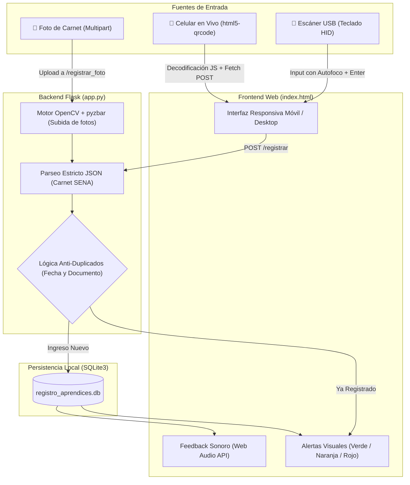

# 🎓 Sistema de Control de Asistencia SENA (Web & Hardware)

Sistema integral y modular para el registro, validación y persistencia de asistencia de aprendices mediante la lectura de códigos QR de carnets institucionales del **SENA**.

Diseñado para soportar múltiples fuentes de entrada:
1. **Escáner Físico USB (Pistola de Códigos de Barras / QR vía emulación de teclado HID)**.
2. **Cámara Móvil Inalámbrica en Vivo (Navegador del teléfono vía Wi-Fi con HTTPS y CA local)**.
3. **Captura Fotográfica de Carnets (Procesamiento y decodificación en backend con OpenCV y pyzbar)**.

---

## 🏗️ Arquitectura del Sistema



---

## 📁 Estructura del Proyecto

```text
Asistencia_QR/
│
├── app.py                         # Servidor Flask principal y API REST
├── requirements.txt               # Dependencias del proyecto
├── test_endpoints.py              # Suite de pruebas automatizadas (6/6 passing)
├── ver_registros.py               # Herramienta CLI para consultar asistencias
├── iniciar_servidor.bat           # Lanzador rápido para Windows (HTTPS por defecto)
├── habilitar_red_celular.bat      # Script batch para habilitar puerto 5000 en Firewall
├── generar_certificados.bat       # Generador de certificados SSL y CA local con OpenSSL
├── progress.md                    # Bitácora de seguimiento y estado del proyecto
├── ESTADO_Y_DIAGNOSTICO_TECNICO.md# Informe técnico detallado de arquitectura
├── README.md                      # Documentación del repositorio
│
├── templates/
│   └── index.html                 # Frontend HTML5 + CSS3 + JS (html5-qrcode)
│
└── [Generados automáticamente al ejecutar]:
    ├── registro_aprendices.db     # Base de datos SQLite local
    ├── cert.pem / key.pem         # Certificados SSL para HTTPS
    └── rootCA.crt                 # Certificado de Autoridad Certificadora para móviles
```

---

## 🚀 Inicio Rápido

### 1. Requisitos Previos
- Python 3.8 o superior instalado.
- Conexión a la misma red local Wi-Fi si se desea usar teléfonos celulares como escáneres.

### 2. Instalación de Dependencias
```powershell
pip install -r requirements.txt
```

> **Nota para Windows:** `pyzbar` incluye binarios precompilados. Si tu entorno reporta falta de bibliotecas compartidas, asegúrate de tener instalado el [Visual C++ Redistributable](https://aka.ms/vs/17/release/vc_redist.x64.exe).

### 3. Iniciar el Servidor

Haz **doble clic en `iniciar_servidor.bat`** o ejecuta en la consola:

```powershell
python app.py --https
```

El servidor iniciará en el puerto `5000`:
- **En este PC**: [https://localhost:5000](https://localhost:5000)
- **En tu teléfono celular**: `https://<TU_IP_LOCAL>:5000` *(ej. `https://192.168.20.21:5000`)*

---

## 🛠️ Modos de Operación

### 1. 🔌 Escáner Físico USB (Pistola de Códigos)
- Los escáneres QR por USB operan bajo el protocolo HID (emulación de teclado): inyectan el string completo y envían la tecla `Enter`.
- La interfaz web incluye un campo de texto con **autoenfoque permanente**.
- Conecta el lector a cualquier puerto USB, abre `https://localhost:5000` y escanea el carnet. El sistema lo procesará instantáneamente sin necesidad de tocar el teclado o ratón.

### 2. 📱 Modo Celular / Móvil (Cámara Inalámbrica Wi-Fi)

Por normativas de seguridad W3C, los navegadores móviles requieren una conexión **HTTPS con certificado de confianza** para permitir la cámara en vivo continua (`getUserMedia`).

#### Opción A: Cámara en Vivo Continua (HTTPS con CA Local)
1. **Generar certificados**: Ejecuta `generar_certificados.bat` (crea `rootCA.crt`, `cert.pem` y `key.pem`).
2. **Iniciar servidor**: Doble clic en `iniciar_servidor.bat`.
3. **Instalar CA en el teléfono Android** (solo una vez por dispositivo):
   - Transfiere `rootCA.crt` al celular (USB, Drive, WhatsApp, etc.).
   - Ve a **Ajustes → Seguridad → Cifrado y credenciales → Instalar certificado → Certificado de CA**.
   - Selecciona `rootCA.crt` y confirma (requiere PIN/bloqueo de pantalla).
4. Abre en Chrome móvil: `https://<TU_IP_LOCAL>:5000` (aparecerá con candado verde/seguro, sin pantallas rojas).
5. Pulsa **"📷 1. Activar Cámara en Vivo"** y enfoca los carnets.

#### Opción B: Modo Foto (Respaldo Universal sin Certificados)
- Pulsa el botón azul **"📸 2. Tomar Foto al Carnet"**.
- Se abre la cámara nativa de tu teléfono y la foto se envía al endpoint `/registrar_foto`.
- El servidor la procesa con OpenCV y pyzbar en el computador, permitiendo registrar carnets desde cualquier celular o navegador sin necesidad de instalar certificados.

---

## 🪪 Formato del Carnet SENA y Reglas de Negocio

El sistema realiza un **parseo estricto de JSON**, adaptado al formato exacto de los carnets institucionales:

```json
{
  "nom": "Diego Alejandro Arboleda Cuero",
  "doc": "CC 1087834596",
  "cargo": "Aprendiz",
  "rh": "O+",
  "ficha": "3564995",
  "dep": "9220",
  "prog": "ANALISIS Y DESARROLLO DE SOFTWARE - 228118 V1"
}
```

### Reglas del Sistema:
1. **Parseo Seguro**: Se captura el string y se parsea con `try ... except json.JSONDecodeError`. Si el código QR escaneado es ajeno al SENA o texto plano, se rechaza con HTTP `400 Bad Request` sin interrumpir el servidor.
2. **Anti-Rebote (Anti-Duplicados)**: Verifica si el `documento` ya cuenta con registro en la `fecha` actual (`YYYY-MM-DD`).
   - Si no existe: Inserta el registro y devuelve `"status": "exitoso"`.
   - Si ya existe: Omite la inserción y devuelve `"status": "duplicado"`.

---

## 📡 Especificación de la API REST

| Método | Endpoint | Descripción | Payload / Respuesta |
| :--- | :--- | :--- | :--- |
| `GET` | `/` | Sirve la interfaz web responsive | HTML |
| `POST` | `/registrar` | Registra asistencia desde string QR | Body: `{"qr_data": "<JSON_CARNET>"}` |
| `POST` | `/registrar_foto` | Sube y procesa una foto con OpenCV | Form-data: `foto` (archivo de imagen) |
| `GET` | `/api/asistencias/hoy` | Consulta asistencias del día en tiempo real | JSON: `{"total": N, "registros": [...]}` |

---

## 📊 Consulta de Registros (CLI)

Para consultar los registros almacenados en la base de datos sin abrir herramientas externas:

```powershell
python ver_registros.py
```

Salida esperada:
```text
=========================================================================================================
REGISTROS DE ASISTENCIA SENA: D:\Repositorios\Asistencia_QR\registro_aprendices.db
=========================================================================================================
ID   | FECHA      | HORA     | DOCUMENTO      | FICHA     | APRENDIZ                     | PROGRAMA
---------------------------------------------------------------------------------------------------------
1    | 2026-10-11 | 22:22:05 | CC 1087834596  | 3564995   | Diego Alejandro Arboleda C.. | ANALISIS Y DES...
=========================================================================================================
```

---

## 🧪 Pruebas Automatizadas

El proyecto incluye una suite completa de pruebas unitarias y de integración que validan los endpoints y la lógica de negocio:

```powershell
python test_endpoints.py
```

Salida esperada:
```text
[PASS] Test 1: Ruta raíz '/' sirve HTML correctamente.
[PASS] Test 2: Primer registro exitoso.
[PASS] Test 3: Anti-rebote confirmado (Ya registrado hoy).
[PASS] Test 4: QR no JSON rechazado limpiamente (400 Bad Request).
[PASS] Test 5: JSON sin datos de carnet rechazado con error 400.
[PASS] Test 6: API /api/asistencias/hoy reporta registros en vivo.

==============================================
TODAS LAS PRUEBAS DE ARQUITECTURA PASARON (6/6)
==============================================
```

---

## 👨‍💻 Autor

- **Diego Alejandro Arboleda Cuero**  
  *Ingeniero Electrónico • Aprendiz ADSO SENA (Ficha 3564995)*  
  GitHub: [@diarboledac](https://github.com/diarboledac)
